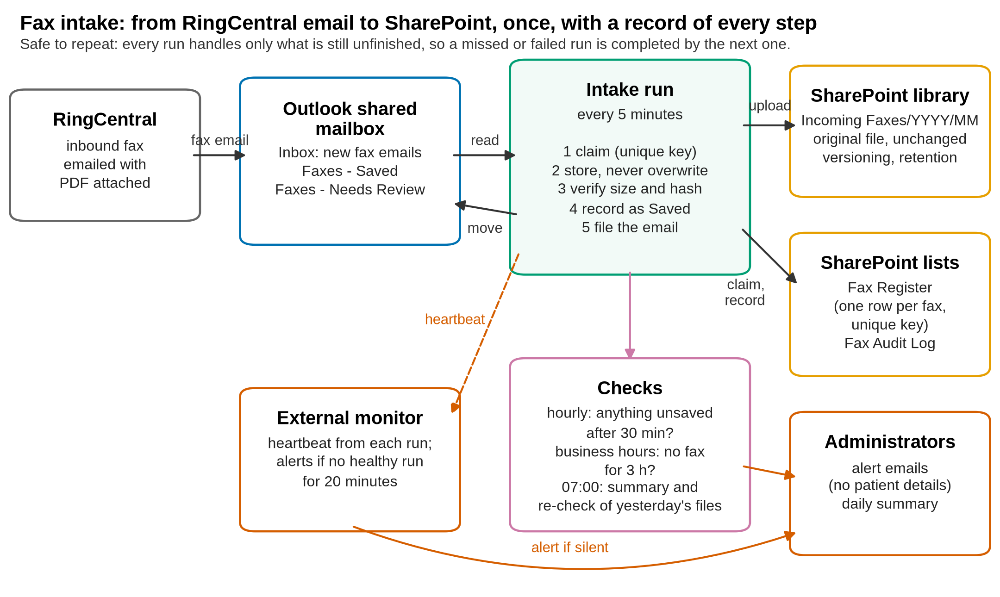

# fax-intake

Saves fax files that arrive by email (for example RingCentral fax-to-email) into a SharePoint
library through Microsoft Graph: each fax stored once, the original unchanged, verified after upload,
recorded in a register and an audit log, with alerts when something stops working.

Built as a reference implementation and test bench for a home health agency's fax workflow. All data
in this repository is fictional.

## How it works



Every run (scheduled every 5 minutes) sweeps the fax emails still in the inbox. For each fax file:

1. **Claim**: create a row in the "Fax Register" SharePoint list keyed on the file's SHA-256; the
   column enforces unique values, so two runs can never both claim the same fax.
2. **Store**: upload with `conflictBehavior=fail` to `Incoming Faxes/YYYY/MM/<date>_<time>_from-<number>_<pages>p_<hash8>.pdf`.
   Nothing is ever overwritten.
3. **Verify**: compare SharePoint's size and QuickXorHash with the bytes read from the email
   (`faxintake/quickxor.py`, checked against rclone's implementation).
4. **Record**: mark the row Saved; write audit rows.
5. **File**: move the email to "Faxes - Saved" (never deleted).

A crash or outage between any two steps leaves a state the next run completes without a second copy:
stale claims are taken over after 15 minutes, an existing upload is recognised by its hash, audit rows
that could not be written wait in a local outbox. Emails from the fax service without a PDF or TIFF go
to "Faxes - Needs Review" with an alert.

Alerts: fax not saved within 30 minutes; no fax emails for 3 business hours; access refused; stored
file does not match. Each run also reports its health to an external heartbeat monitor
(`FAXINTAKE_HEARTBEAT_URL`), which alerts if no healthy run arrives for 20 minutes, covering failures
that would also stop the service's own email alerts. `python -m faxintake daily` sends a morning
summary and re-checks every file saved the day before.

## Layout

| Path | Contents |
|---|---|
| `faxintake/` | The service: Graph client with retries, processor, audit and alerts, daily summary, sign-in |
| `sim/` | Graph stand-in with fault injection, month-long scenarios, a basic-flow baseline, summary |
| `tests/` | Unit tests, behaviour tests (lost responses, crashes, outages, parallel runs), test-pack replay, regression fixture |
| `testpack/` | Generator and output of 12 fictional fax emails (.eml) with fax PDFs and a manifest of expected outcomes |
| `runs/` | Results of the 15 simulated months (tag `frozen-sim`) |
| `scripts/` | Figures and sample outputs (register and audit log workbook, alert emails) |
| `docs/` | Figures and samples |

## Run

```bash
python -m venv .venv && . .venv/bin/activate
pip install -r requirements.txt
pytest -q                                    # 29 tests
bash sim/run_all.sh python                   # 15 simulated months, about 5 minutes with 5 processes
python scripts/make_figures.py runs docs
python testpack/make_testpack.py testpack/out
python scripts/make_samples.py testpack/out docs
```

Against a real tenant (app registration with Mail.ReadWrite scoped to the fax mailbox through Exchange
RBAC for Applications, and Sites.Selected on the intake site):

```bash
export FAXINTAKE_TENANT_ID=... FAXINTAKE_CLIENT_ID=... FAXINTAKE_CLIENT_SECRET=...
python -m faxintake run --config config.yaml     # schedule every 5 minutes
python -m faxintake daily --config config.yaml   # schedule at 07:00
```

## Results (simulated)

Across 15 simulated months (20,996 distinct fictional fax files, everyday faults and 7 incident types),
the service lost 0 faxes, stored 0 duplicates and alerted on 35 of 35 incidents. A basic
"save each attachment" flow replayed against the same traffic lost 124 faxes and stored 1,189 duplicates.
See `runs/summary.md` and `runs/summary.json`.

Limits: the Graph stand-in follows Microsoft's documentation but is not a real tenant; fax files in the
month-long runs are random bytes; the notification email layout is illustrative.

## Licence

MIT
